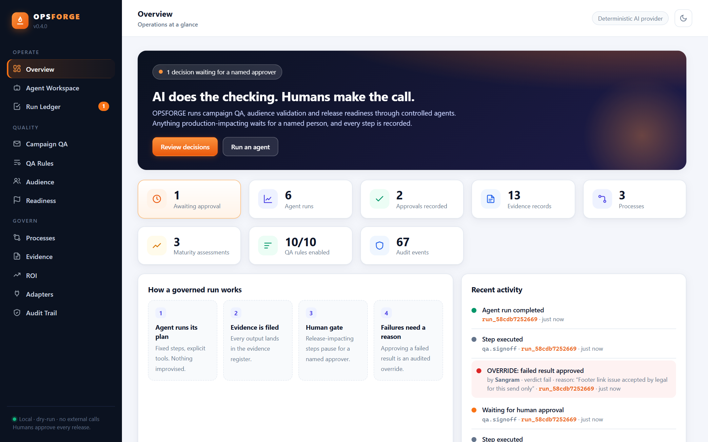
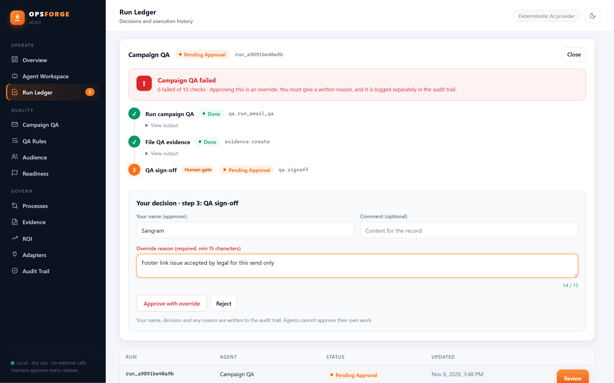
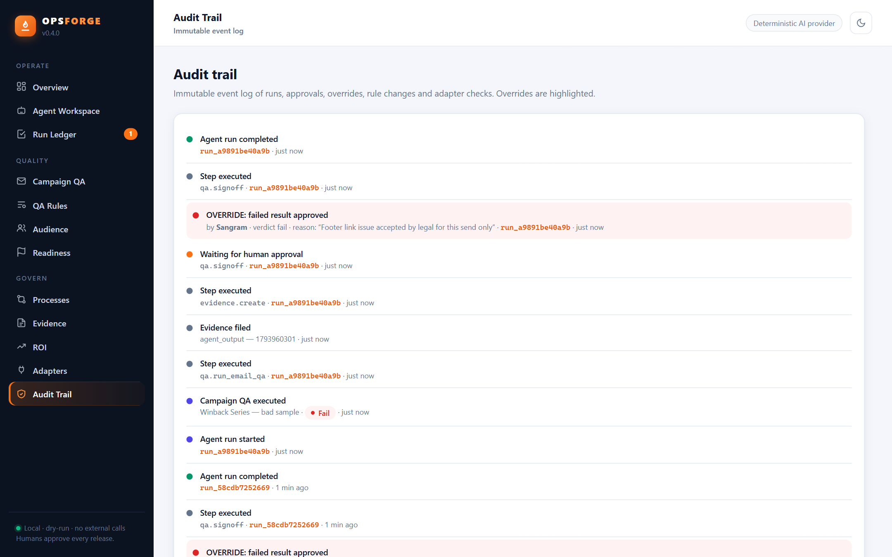
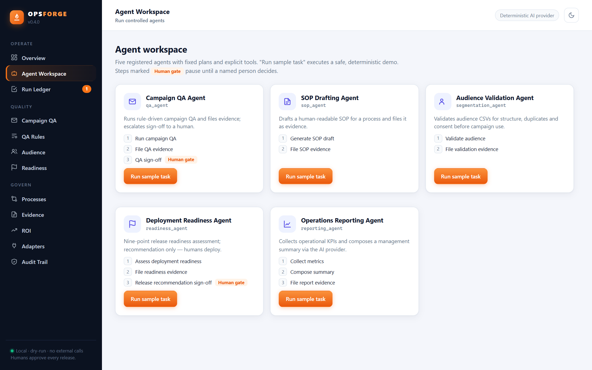
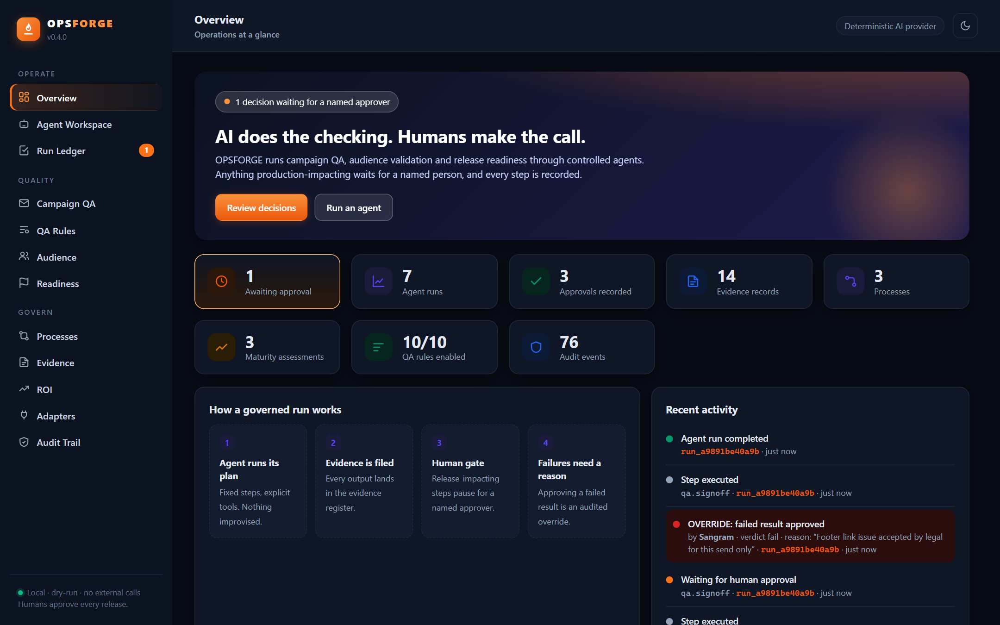

# OPSFORGE

**AI does the checking. Humans make the call.**

OPSFORGE is a local platform for marketing and CRM operations teams. Controlled AI agents run campaign QA, audience validation and release-readiness checks. Anything production-impacting pauses for a named human approver, and every step lands in an audit trail.

[**▶ Watch the 2-minute walkthrough**](https://sghatge.github.io/opsforge/) · [Download v0.4.0](https://github.com/sghatge/opsforge/releases/latest) · [Changelog](CHANGELOG.md)



---

## Why it exists

Most "AI for operations" demos let the agent act and ask questions later. In campaign operations that is how a broken email reaches a million inboxes. OPSFORGE starts from the opposite assumption:

| Principle | How it's enforced |
| --- | --- |
| **Agents are defined, not improvised** | Every agent has a fixed plan and explicit tools. Nothing outside the plan runs. |
| **Humans gate sensitive outcomes** | QA sign-off and release recommendations pause until a named person approves. Agents cannot approve themselves. |
| **Failures can't be waved through** | Approving a failed QA or NOT READY result is an *override*: it needs a written reason and is logged as its own audit event. |
| **Everything is traceable** | Each run, step, output, approval and override is persisted in a run ledger and audit trail. |

## The governed approval flow

When a Campaign QA run fails, the approval screen says so plainly, and **Approve** stays locked until a reason is written:



The override is then recorded with the approver, verdict and reason, and highlighted in the audit trail:



## What's inside

| Capability | Description |
| --- | --- |
| Agent workspace | Five registered agents: Campaign QA, SOP Drafting, Audience Validation, Deployment Readiness, Operations Reporting |
| Human approval workflow | Approval-gated steps pause runs until a named person decides |
| Override control (v0.4) | Failed results need a written reason (min 15 chars); logged as `approval.override` |
| Campaign QA engine | Rule-driven checks; rules are data, editable at runtime without code changes |
| Audience validation | CSV structure, duplicates, contact format and explicit-consent checks |
| Deployment readiness | Nine-point release gate; readiness opinion only, humans deploy |
| Process register | Five-dimension maturity scoring and SOP draft generation |
| ROI calculator | Net value including implementation, maintenance and review costs |
| Evidence register & audit | Every output and decision is persisted and traceable |
| Integration adapters | Mock CRM and an Adobe Campaign interface stub, both dry-run only |

<p align="center"> </p>

## Run it

Requirements: **Python 3.10+**. No third-party packages.

```bash
git clone https://github.com/sghatge/opsforge.git
cd opsforge
python -m opsforge --demo
```

Then open <http://127.0.0.1:8765>. `--demo` seeds a realistic, fully synthetic sample environment, including one release decision waiting for your approval in the **Run Ledger**.

Options: `python -m opsforge --port 8901 --db /path/to/opsforge.db [--demo]`

**Try it in 60 seconds**
1. Open **Run Ledger** → click **Review** on the waiting run → enter your name → **Approve**.
2. Go to **Agent Workspace** → **Run sample task** on *Campaign QA Agent*. The sample campaign fails QA.
3. Open the run: **Approve** is locked until you write an override reason. Approve it, or reject it.
4. Check **Audit Trail**: the override is highlighted with your name and reason.

## Tests

```bash
python -m unittest discover -s tests -t .
```

72 automated tests cover the services, agent layer, override control, demo seeder and live HTTP integration.

## Honest limitations

- This is a **local MVP**, not a production deployment.
- The AI layer uses a **deterministic, template-driven provider**; there are no external LLM calls. A real provider can be plugged in via `OPSFORGE_LLM_PROVIDER` (see [docs/AGENT_FRAMEWORK.md](docs/AGENT_FRAMEWORK.md)).
- **Adobe Campaign connectivity is not implemented.** The adapter is a dry-run interface stub; no credentials are read or stored.
- No authentication, multi-user access or role-based access yet.
- A minimum-length reason stops empty overrides, not meaningless ones. Two-person approval for overrides is on the roadmap.
- All demo data is synthetic. Do not connect this to a live production environment without the security work in the roadmap.

## Roadmap

| Release | Capability |
| --- | --- |
| v0.3 | Agent layer, configurable QA rules, approvals, adapters, run ledger, demo mode |
| **v0.4 (current)** | Failed-result override control, redesigned dashboard, walkthrough video |
| v0.5 | Authentication, role-based access, two-person approval for overrides, approval delegation |
| v1.0 | Enterprise-ready operational intelligence platform |

## Repository structure

```
opsforge/
├── README.md · ARCHITECTURE.md · IMPLEMENTATION_SPEC.md · CHANGELOG.md · LICENSE
├── pyproject.toml
├── opsforge/
│   ├── __init__.py · __main__.py · server.py · db.py
│   ├── services/            # processes, sop, qa, roi, segmentation,
│   │                        # readiness, adapters, agents, demo
│   └── static/index.html    # dashboard
├── docs/
│   ├── index.html           # project page (GitHub Pages)
│   ├── media/               # screenshots and walkthrough video
│   ├── AGENT_FRAMEWORK.md
│   └── PROCESS_SOP_TEMPLATE.md
└── tests/
```

## Author

Built by **Sangram Ghatge**, Marketing Ops & CRM technology lead (Adobe Campaign Classic v8, Salesforce, AI operations).
[LinkedIn](https://www.linkedin.com/in/sangram-g-2369705b) · [GitHub](https://github.com/sghatge)

## License

Copyright © 2026 Sangram Ghatge. All rights reserved. The code is published for viewing and evaluation; see [LICENSE](LICENSE).
